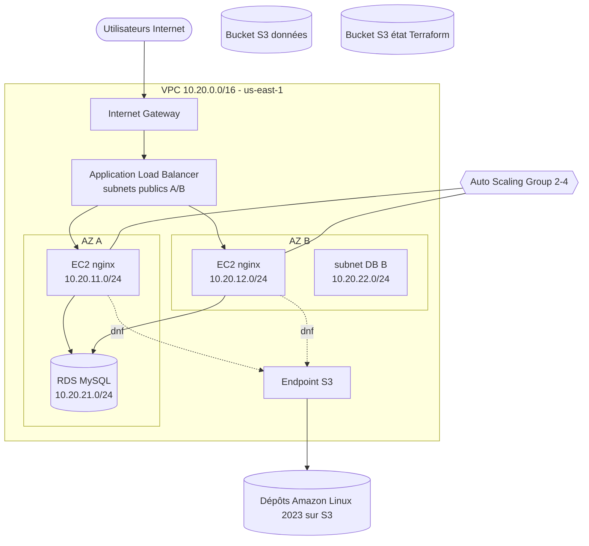

# Architecture



## Flux de déploiement

```
Développeur -> branche -> Pull Request -> GitHub Actions
   fmt -check -> init -> validate -> plan (commentaire PR + artefact)
   merge sur main (protégée) -> apply manuel (validation pour test/prod)
   Terraform -> AWS : réseau, sécurité, ALB, Auto Scaling, RDS, S3
   État -> s3://cloud5-tfstate-<compte>/<env>/terraform.tfstate (chiffré, versionné, verrouillé)
```

## Plan d'adressage (dev)

| Composant | CIDR |
|---|---|
| VPC | 10.20.0.0/16 |
| Public A / B | 10.20.1.0/24, 10.20.2.0/24 |
| App A / B | 10.20.11.0/24, 10.20.12.0/24 |
| DB A / B | 10.20.21.0/24, 10.20.22.0/24 |

test : 10.30.0.0/16 · prod : 10.40.0.0/16 (mêmes offsets, dérivés par `cidrsubnet`).
